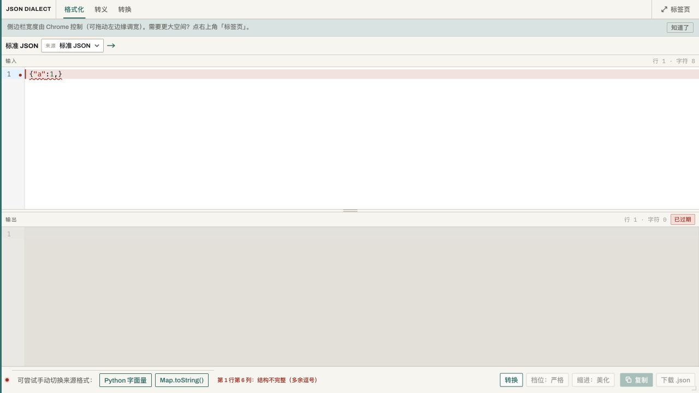

# 项目审查与优化建议

更新：本报告为修复前基线。后续缺陷修复与验证见 [修复记录](../05-缺陷/2026-10-19-审查缺陷修复记录.md)。

日期：2026-10-19。审查基线：HEAD `8f5e254`，产品 v1.3.0，PRD 首页标注 v1.5。

结论：主要功能路径已具备，适合继续围绕本地数据转换完善。但存在已复现的数据失真、非法输出、操作入口失效和状态串扰问题，应先修复，再扩展功能。现有测试全部通过不能代表这些边界已覆盖。

本次只评估，不修复业务代码。新增本报告与浏览器截图；审查用临时测试在验证后删除。

## 1. 项目理解与审查范围

项目是纯本地 Chrome 扩展，侧边栏为主入口，独立标签页承接大空间操作。面向开发者的主要价值是将调试器、接口返回、Java 常量、日志里的文本变成可以直接使用的数据。

| 功能 | 实现及典型使用场景 |
|---|---|
| 格式化 | 自动判定来源，同格式输出，严格/容错与美化/压缩；用于阅读、整理接口数据 |
| 转换 | Python、JSON、Java 转义、Map 四种来源；JSON、Python、Java 三种目标；用于构造测试数据和跨语言联调 |
| 转义 | JSON、Java、URL、Base64；纯文本编码/解码；用于处理代码常量、参数和编码文本 |
| 修正与报错 | 修正记录、重复键提示、错误行、日志前缀确认剥离；用于排查脏数据 |
| 类型调整 | Map 推断值按路径覆盖；用于纠正订单号、布尔和空值等推断 |
| 结果交付 | 程序产物复制、下载；侧边栏转独立标签页继承会话 |
| 性能与隐私 | 防抖、大文本降级、局部 deadline；偏好写 local，会话交接写 session；无现有业务网络调用 |

阅读范围包含 README、文档索引、现行 PRD、需求与技术评审、设计规范、版本交付与迭代决策、core/UI 实现、测试、样本及构建/校验工具。查看了历史 320px 界面截图，并在本地浏览器运行当前页面验证严格报错交互。

保留价值：纯函数内核与界面分离；数字以文本保存；重复键以条目保留；复制下载不依赖 DOM；三个功能入口和侧边栏/标签页形态明确。无需为了这些问题整体重写项目。

## 2. 验证结果与边界

- `npm run verify:all` 通过：TypeScript、12 文件/232 测试、54 个已保存输出样本的目标语言解析检查、构建、隐私静态检查。
- 现有基准：500 行 P95 16ms；5000 行最慢 252ms，均为本次机器上的单次测试结果。
- 增补 12 组临时审查探针，确认 core、controller、CodeMirror 配置和存储等待等现有行为。探针通过表示问题行为被成功复现，不表示问题已经修复。
- 用本机 Python `ast.literal_eval` 独立核对未知反斜杠、`\U0001F600`、Python 尾逗号语义。
- 在本地浏览器页面实际输入 `{"a":1,}`，确认报错后容错切换按钮被禁用，截图见文末。
- 未在真实 Chrome 扩展上下文重新验证侧边栏跨标签页存活、worker 回收、扩展 CSP、真实剪贴板权限和跨窗口会话竞争。浏览器验证是 localhost 页面，不能替代这些验收。
- 构建有约 528KB 主 JS 分块提示，属于体积优化线索，尚无冷启动测量证明其构成用户缺陷。

## 3. 优先修复的问题

P1：优先进入下一修复批次，涉及结果可信度、主要操作受阻或明显卡顿。P2：后续修复，涉及状态一致性、定位、交互及可达性。以下优先级是本次建议。

### D01 · P1 · 非法数字被当作成功结果输出（已复现）

锁定 JSON、严格模式、目标 JSON：`{"n":1e}` 和 `{"n":1-2}` 均返回 `status=ok`，输出保留非法数字；`JSON.parse` 均失败。

位置：`src/core/lexer.ts` 数字扫描；`src/core/parse/engine.ts:376`；`src/core/serialize/toJson.ts`。

原因：扫描器接受宽泛字符组合，解析器只去前导零，没有验证整个数字是否满足来源及目标语法。

建议：按格式验证数字 token，保持大整数原文；不能使用 `Number()` 替代语法判断。Python 合法但 JSON 不兼容的数字须明确规范化，无法确定的输入报错。

验收：非法指数、连续符号报错；合法大整数精度保留；任何标记成功的 JSON 结果均能被独立 JSON 解析器接受。

### D02 · P1 · 反转义静默改变字符串内容（已复现）

- Python 输入 `{'path':'C:\project'}` 输出 `{"path":"C:project"}`，反斜杠丢失。
- Python 输入 `{'emoji':'\U0001F600'}` 输出 `{"emoji":"U0001F600"}`，而 Python 实际求值为 `😀`。
- 两例均返回 `ok`，没有修正提示。

位置：`src/core/escape.ts:115`，尤其 default 分支；`src/core/lexer.ts` 共用解码。

建议：按来源语言处理转义；不支持的序列保留或明确报错，不能默默去掉反斜杠。将这些用例加入 Python 独立解释器语义对照。

验收：转换前后字符串值相等；未知转义、Unicode 长转义、路径与正则文本有专项覆盖。

### D03 · P1 · 严格模式未形成正确语法边界（已复现）

锁定 JSON 严格模式：`{'a':1}` 被接受并改成双引号，`{"a":(1,2)}` 被接受并变成数组，`{"a":1} #comment` 被修复成功。锁定 Python 严格模式：合法的 `{'a':1,}` 却报错。

位置：`src/core/index.ts:200`；`src/core/parse/engine.ts` 键、数组/元组、尾逗号、字符串分支。

原因：注释在严格检查前已过滤；键和容器未完整区分语言；尾逗号统一拒绝。

建议：严格模式按来源语法验证，禁止其进入修复；Python 合法语法不能沿用 JSON 的拒绝规则。与 D01/D02 共用修复批次，但分别建立测试。

验收：JSON 非法语法不输出成功；Python 合法字面量接受；容错改动均有记录。

### D04 · P1 · 解析失败后无法切换容错（jsdom 与浏览器均复现）

默认格式化输入 `{"a":1,}`，报错后“档位：严格”按钮 disabled，点击不能切换。空白页也不能提前选择容错。

位置：`src/ui/controller.ts:839`，`setButtons(false)` 同时禁用复制、下载和档位按钮。

建议：分离“是否有可导出结果”和“是否允许调整处理选项”；档位及来源调整在失败态保持可用。

验收：错误态直接切换容错后得到结果；错误态复制、下载仍禁用。

### D05 · P1 · Map 类型覆盖与目标格式不一致（已复现）

转换页选择 JSON，输入 `{a=1}`，将 `/a` 改成字符串：目标控件仍为 JSON，实际输出却变成 Python `{'a':'1'}`。直接调用内核指定 JSON 与覆盖时，结果仍是数字 `1`，覆盖未生效。

位置：`src/ui/controller.ts:696` 类型回调；`src/core/index.ts` serialize；`src/core/serialize/toPython.ts`。

原因：类型回调重新 convert 时丢失 target 等处理选项；覆盖只在 Python 序列化器内实现。

建议：类型覆盖先作用于公共数据表示，再按目标输出；重新渲染沿用当前处理选项。界面显示、输出高亮、文件后缀和实际内容同步。

验收：JSON/Python/Java 三种目标下，类型微调后目标保持不变，复制与下载一致。

### D06 · P1 · 类型纠正无法恢复原始值，路径会互相影响（已复现）

- `{a=0012}` 手动改为字符串，输出 `'12'`，无法恢复订单号 `'0012'`。
- `{a/b=1, a={b=2}}` 调整 `/a/b`，两个值同时变为字符串。

位置：`src/core/parse/mapText.ts:161`、`:218`；`src/core/serialize/toPython.ts:19`。

原因：原始文本虽存在于 ValueSlot.raw，但覆盖使用已规范化节点；路径以 `/` 直接拼接，不能区分键名中的斜杠和嵌套路径。

建议：类型调整使用原始值；路径段明确转义，重复条目采用不碰撞的内部标识。无法合法转为数字时提示，避免静默替换成 0。

验收：前导零可恢复；含 `/`、`~`、重复键的字段能单独调整。

### D07 · P1 · 大文本待处理时仍能复制旧结果（已复现）

先成功转换短 JSON，再通过编辑器替换为 500001 字符。实时转换停止，但复制按钮仍启用、旧结果没有过期标记。原来的小文本防抖任务也没有在该提前 return 分支被取消。

位置：`src/ui/controller.ts:549`。

建议：任何输入变化立即使旧输出失效并取消旧任务；超过阈值时显示“待手动处理”，只在当前输入处理成功后恢复导出。

验收：大文本替换后不能复制上一份数据；快速输入、小文本→大文本切换不会被旧任务覆盖。

### D08 · P1 · 超时与大文本降级未覆盖完整链路（已复现及源码确认）

平铺对象实测（JSON→JSON，timeoutMs=3000）：

| 字段数 | 字符数 | 耗时 | 返回状态 |
|---|---:|---:|---|
| 5000 | 62781 | 148ms | ok |
| 10000 | 127781 | 559ms | ok |
| 20000 | 277781 | 2236ms | ok |
| 30000 | 427781 | 4171ms | ok |

另：Map 5000 字段传入已过期 deadline 仍成功；`setHighlight(false)` 后 CodeMirror language facet 仍为 JSON，语言扩展没有实际卸载。

位置：`src/core/parse/engine.ts:114` 每个字段 slice/filter 前序条目，形成 O(n²)；`src/core/index.ts:200` 词法扫描先于 deadline；`src/core/parse/mapText.ts:246` 未使用 deadline；`src/ui/editor.ts:130`、`:159` 两处语言扩展配置。

建议：重复键编号使用一次计数；deadline 覆盖扫描、Map、值收集与输出阶段；关闭高亮时卸载实际语言配置。先按现有 checkpoint 架构修复，再测量是否需要其他执行方式。

验收：平铺对象与深嵌套均测；超时返回 timeout；输入仍可操作；降级开关确实改变编辑器配置。本次未测浏览器大文本帧率，不能把上述内核时间当成完整 UI 延迟。

### D09 · P1 · 标签页迁移仍可能被 storage 写入永久阻塞（模拟复现）

模拟 `chrome.storage.session.set()` 永不完成，`writeSession()` 一直 pending；`handleEnlarge()` 在它之后才执行 `window.open`。初始化已有的超时保护并未覆盖这个关键操作。

位置：`src/ui/sessionState.ts:25`；`src/ui/controller.ts:913`。

建议：写入也有超时和可见失败状态；状态未可靠交接时保留原侧边栏内容。是否打开空标签页应明确提示，避免用户以为输入已继承。

验收：成功、拒绝、永不 settle 三种路径都能结束；迁移失败时原内容可恢复。真实扩展行为仍需单独验收。

## 4. 状态与交互缺陷

| 编号/优先级 | 证据及影响 | 位置与建议 |
|---|---|---|
| D10 / P2 | 自动识别为 Python 后，原生 select.value 已为 python，但自绘按钮仍显示“标准 JSON”（已复现） | `src/ui/select.ts:152` 只监听 change，程序赋值不触发；建立显式同步方法。来源、目标、历史偏好和会话继承统一更新可见标签 |
| D11 / P2 | 覆盖 `/a` 后输入改为 `{b=2}`，再改回 `{a=3}`，旧覆盖重新生效；清空再输入也仍生效（已复现） | `controller.ts:565`、`:865` 未清理覆盖；按 PRD §7.6 清空时重置，解析成功后清理已消失路径。路径仍存在时保留覆盖是既定需求，不应误修 |
| D12 / P2 | 三个 tab 实际共享输入及 controller 的锁定、覆盖状态，与 FR-L4 的“不共享”冲突（共享输入已复现，其他状态由源码确认） | `controller.ts:420`；这是需求/实现不一致。实施前确认要按既有独立工作区约定修复，还是正式改为共享；不能在审查阶段替用户决定 |
| D13 / P2 | 确认剥离 `INFO ` 后换一份 `INFO {"a":2}`，会复用上次剥离决定（已复现） | `controller.ts:549` 输入变更未重置 strippedPrefix；新输入重新确认，并清理旧提示；迁移会话也需明确是否保留该处理决定 |
| D14 / P2 | 分隔条从 y=500 移到 501，直接把输入 flex 设置成 0.7，未从当前比例增量调整（已复现） | `controller.ts:961`、`:988`；保存起始比例，用起始比例+位移计算。`applySplit` 的 flex 映射也不是真实比例。比例持久化字段有定义但未接入保存/恢复 |
| D15 / P2 | 自绘下拉只有 Escape 键处理，方向键/Enter 无法选择；原生 select 被移出键盘序列和无障碍树（源码及事件探针确认） | `select.ts:144`；补全键盘焦点/选项导航/确认语义，或使用原生控件。修正记录的展开也应提供键盘入口 |
| D16 / P2 | 多行 Map 第三行缺 `=`，报第 1 行第 9 列；`{a=1} {b=2}` 被当作一个 Map，输出 a 值 `1} {b=2`（已复现） | `mapText.ts:190`、`:218`、`:246`；跟踪原文偏移，验证完整根结构与尾部残留。Map.toString 本身存在不可逆歧义，不应承诺所有文本都能无损恢复 |
| D17 / P2 | 合法 Map 键中 `/` 被 lexer 标为“补齐缺失的右括号”；普通合法转义也可能进入“修正”列表（前者已复现） | `lexer.ts`、`index.ts`；区分词法观察与实际修复，不能把其他格式扫描产生的 marks 无条件当成 Map 修复 |

补充源码风险，未做真实扩展端到端复现：

- 复制失败后 `controller.ts` 调用 `setEditable(true)`，后续没有恢复只读；用户可能修改可见输出，但复制下载仍取程序旧结果。应在只读状态全选，避免引入两份结果。
- 会话只用固定 KEY，多窗口同时迁移可能相互覆盖；建议单次交接标识，只在确实需要支持并发窗口时落实。
- 异步偏好读取完成后会覆盖用户刚操作的 tab/目标；建议“当前操作 > 读取到的旧偏好 > 默认值”，增加慢读取测试。
- 自动报错 `highlightLine()` 会修改编辑器 selection，可能打断正在输入的位置；应区分自动标记与用户点击“定位错误”。

## 5. 功能提升与新增候选

以下是评估建议，未实施，也不代表需求已经确认。成本仅为相对判断，需在范围确定后估算。

| 顺序 | 候选 | 使用场景与价值 | 范围和验收建议 | 成本 |
|---|---|---|---|---|
| 1 | 类型纠正面板增强 | 日志订单号、金额、空值推断需要快速确认 | 显示原文、推断类型、手动类型；支持按路径过滤、点击定位；大列表只渲染可见项。D05/D06 修好后实施 | 中 |
| 2 | “将输出作为输入” | 先去转义，再格式化/转换，省去反复复制粘贴 | 显式操作、可撤销；过期/失败结果不可使用；不自动覆盖原输入。跨 tab 如何转交须与 D12 一起明确 | 低–中 |
| 3 | 修正记录定位与前后对照 | 判断容错是否改变了业务数据 | 点击修正定位原文，展示 before/after；区分格式修正与值变化。属于现有修正能力增强，不扩展成完整 Diff 工作台 | 中 |
| 4 | 本地文件导入/拖入 | 处理较长日志或请求响应文件 | 用户主动选择文件，本地读取；覆盖现有输入有明确动作；大小与编码失败提示；不保存历史 | 低–中 |
| 5 | 显式 JSON Lines/批量记录模式 | 一次处理多条日志或接口记录 | 默认单文档模式继续拒绝并列值；批量模式逐条处理、标明行号，失败不能静默跳过；数组合并还是逐行输出须先确定 | 中–高 |
| 6 | 多层转义逐层预览 | 日志/代码中重复转义的 JSON | 每次显式解一层并预览，可撤销；不自动循环“解到成功”。先修 D02 再考虑 | 中 |

推荐先做前 3 项。JSON Lines 是明确的新范围，优先级取决于实际使用频率；本次不默认立项。

现有 NG1/NG5/NG6/NG7/NG8 对历史记录、云端能力、多格式、JSON 工具箱及配置项有明确限制。此次不把云同步、AI 转换、YAML/XML/CSV、Schema/JSONPath/完整 Diff、键排序和大量设置开关列为默认方向。编辑器已经使用 CodeMirror basicSetup，搜索/折叠等能力应先核实当前可用性，避免重复开发。

## 6. 交互优化方案

1. **分开处理选项与结果动作。** 来源、目标、严格/容错始终可调整；复制、下载根据结果有效性启用。错误态提供直接可点击的“尝试容错”。
2. **把状态讲清楚。** 待输入、待处理、成功、已修正、失败/过期分开呈现；正常成功目前 `setStatus('')` 会让状态灯回到灰色，反而初始提示是绿色。颜色应与实际状态一致。
3. **显示实际输出格式。** 输出标题显示“JSON / Python / Java / 文本”，自动目标也展示解析后的实际目标；格式化和转义页隐藏没有目标的孤立箭头。自绘下拉同步问题先修。
4. **优化窄屏信息密度。** 保留现有视觉风格；侧边栏优先展示工作区与复制，品牌、宽度帮助、下载可降低占用；独立标签页可提供左右对照布局。不是本次必须重设计。
5. **让错误定位不打断编辑。** 自动转换只标记错误，用户主动点击时再移动光标；Map 行列必须先修正确。
6. **提供清晰重置范围。** 区分“清空当前工作区”“恢复自动来源”“清除类型覆盖”；清空后不残留旧提示和旧覆盖。tab 独立还是共享应先统一契约。
7. **转义按钮按场景命名。** URL/Base64 可显示“编码/解码”，JSON/Java 显示“增加/去除转义”；底部“反向”明确是切换处理方向，不暗示自动使用输出作为输入。
8. **键盘流程完整。** 下拉、tab、修正明细、分隔条均可键盘操作；不要求增加已经被排除的自定义快捷键功能。

## 7. 文档与测试体系改进

文档存在明确漂移：

- PRD 首页 v1.5，文末仍写 v1.2、待进入研发阶段。
- NG4 仍写“不做严格模式开关”，FR-K 已明确默认严格及容错开关。
- US-17/Q8 仍将 Java 目标列为未来，而现有代码已实现。
- FR-L4 独立 tab 状态与代码共享状态不一致。
- README 的 AC-81 已真机确认，交付总览仍有待人工表述。需要维护一个现行验收状态表，历史报告保留日期和当时结论。

测试改进重点：

- `verify_with_python.py` 检查的是仓库已保存的 `.out.*`，不是本次引擎刚生成的结果。发布门禁应把当前引擎输出写入临时目录，再交给独立解释器验证，不能覆盖黄金期望后再自证通过。
- 属性测试主要用本项目解析器往返，双方共享错误可能相互掩盖。加入独立 JSON/Python 语义比对，重点覆盖原生 Python 转义、非法数字、非字符串键与元组。
- UI 测试应断言用户看到的自绘标签、disabled 状态、实际目标与结果内容，而非只读原生 select.value。
- 性能样本加入平铺大对象、深层数组、Map、大字符串及临界阈值切换，不能只按“行数”代表复杂度。
- 恢复与失败链路补：storage 永不 settle、复制失败、快速替换输入、旧防抖任务、类型覆盖删除/清空、跨页继承。
- 隐私静态扫描通过只证明已扫描模式未命中，不能替代生产构建在真实扩展上下文的网络观测。本次没有发现数据外传路径，也没有验证全部依赖安全。

## 8. 建议实施顺序与成功标准

| 阶段 | 工作 | 验证 |
|---|---|---|
| A：结果正确 | D01/D02/D03/D05/D06/D16，先写失败复现，再修解析/覆盖 | 成功输出能被目标解释器解析；字符串与数值语义一致；覆盖不改目标且互不串扰 |
| B：操作与状态 | D04/D07/D09/D10/D11/D13，先锁定错误态和异步场景 | 失败可改档位；旧结果不可导出；迁移有终态；标签与真实状态一致 |
| C：性能与交互 | D08/D14/D15/D17，及已确认的状态工作区方案 | 超时有效；高亮真实降级；分隔连续；全键盘完成基本操作 |
| D：小步增强 | 从类型面板、输出转输入、修正定位中按实际频率选取 | 用真实工作样本比较需要手工修改/复制次数；每项新增有独立验收 |

实施前需要产品明确的主要事项：tab 工作区是否继续按 FR-L4 独立；是否立项批量记录及其失败/输出规则；是否接受新文件导入与跨功能转交动作。这些不影响本次审查结论。

## 9. 浏览器证据

本地当前页面：输入带尾逗号 JSON 后报错，“档位：严格”不可用。此截图用于证明普通页面交互，不代表 Chrome 扩展上下文验收。

